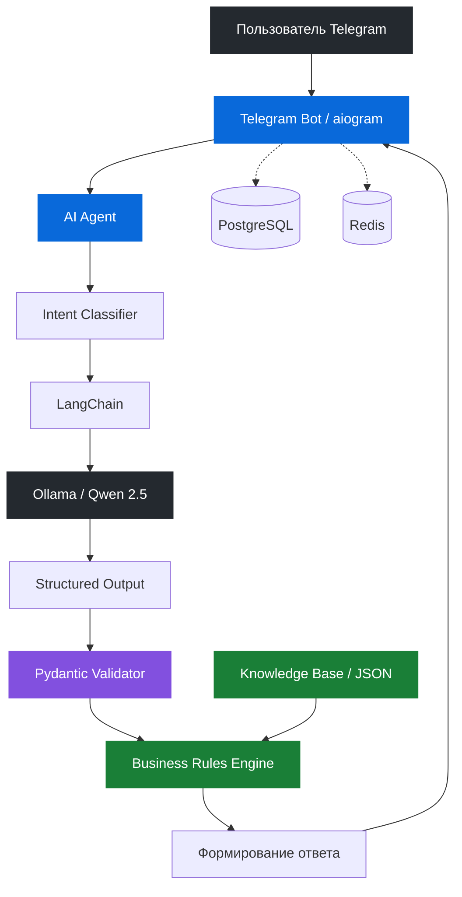

<div align="center">

# AI Shop Assistant

### AI-ассистент технической поддержки интернет-магазина

Telegram-бот на Python с локальной языковой моделью для автоматизации клиентской поддержки.

**Классификация обращений · Обработка нескольких намерений · Бизнес-правила · Локальная LLM**

<br>


</div>

---

## О проекте

**AI Shop Assistant** — Telegram-бот для автоматизации клиентской поддержки интернет-магазина с использованием локальной языковой модели.

Система принимает сообщения пользователей на естественном языке, определяет намерения и формирует ответы на основе заранее заданных правил магазина.

В отличие от обычных чат-ботов с фиксированными командами, ассистент способен понимать свободно сформулированные вопросы и обрабатывать несколько запросов одновременно.

**Ключевая особенность проекта — разделение AI-классификации и бизнес-логики.**

Языковая модель используется исключительно для понимания пользовательского запроса. Формирование ответа происходит на стороне Python-приложения на основе проверенных данных.

Такой подход снижает риск галлюцинаций LLM и позволяет контролировать корректность ответов.

---

## Возможности

- **Классификация намерений** — определение темы обращения с помощью локальной LLM.
- **Multi-intent обработка** — распознавание нескольких вопросов в одном сообщении.
- **Structured Output** — получение структурированного ответа модели с использованием Pydantic.
- **Валидация намерений** — проверка результатов классификации перед выполнением бизнес-логики.
- **Детерминированные ответы** — формирование ответов на основе правил интернет-магазина.
- **Локальная языковая модель** — работа через Ollama без использования платных облачных LLM API.
- **Обработка ошибок** — резервные ответы при недоступности языковой модели.
- **Автоматическое тестирование** — проверка AI-агента и бизнес-правил с помощью pytest.
- **Контейнеризация** — запуск инфраструктуры через Docker Compose.

---

## Архитектура

Приложение построено по модульному принципу с разделением ответственности между компонентами.



### Этапы обработки запроса

**1. Получение сообщения**

Telegram-бот получает сообщение пользователя через aiogram.

**2. Классификация**

Текст передаётся в локальную языковую модель Qwen 2.5 через LangChain.

**3. Структурирование**

Модель возвращает структурированный результат с обнаруженными намерениями пользователя.

**4. Валидация**

Pydantic проверяет структуру полученных данных. Дополнительная валидация проверяет корректность намерений.

**5. Применение бизнес-правил**

Каждое намерение обрабатывается отдельной логикой на основе регламента магазина.

**6. Формирование ответа**

Результаты объединяются и отправляются пользователю в Telegram.

---

## Пример работы

**Запрос пользователя:**

> Сколько стоят наушники X1 и когда их доставят?

**Результат классификации LLM:**

```json
{
  "intents": [
    {
      "intent": "product",
      "topic": "price"
    },
    {
      "intent": "delivery",
      "topic": "delivery_time"
    }
  ]
}
```

**Обработка бизнес-логикой:**

```text
Намерение №1:
  Категория: product
  Тема: price
  Результат: 2490 рублей

Намерение №2:
  Категория: delivery
  Тема: delivery_time
  Результат: следующий день, 18:00–21:00
```

**Ответ ассистента:**

> Наушники X1 стоят 2490 рублей.
>
> Доставка курьером осуществляется на следующий день с 18:00 до 21:00.

Модель определяет, какую информацию запрашивает пользователь, но не генерирует стоимость товара или условия доставки самостоятельно.

Все фактические данные берутся из регламента интернет-магазина.

---

## Технологический стек

| Компонент | Технология | Назначение |
|---|---|---|
| Язык | Python 3.12 | Основная разработка |
| Telegram API | aiogram 3 | Обработка сообщений |
| LLM | Qwen 2.5 1.5B | Классификация намерений |
| LLM Runtime | Ollama | Локальный запуск модели |
| AI Framework | LangChain | Интеграция с языковой моделью |
| Валидация | Pydantic | Structured Output |
| База данных | PostgreSQL | Хранение пользователей |
| ORM | SQLAlchemy | Работа с базой данных |
| Redis | Redis | Инфраструктурный компонент |
| Контейнеризация | Docker Compose | Развёртывание сервисов |
| Тестирование | pytest | Автоматические тесты |

---

## Структура проекта

```text
shop_ai_assistant/
│
├── app/
│   ├── ai_agent/
│   │   ├── agent.py
│   │   ├── llm.py
│   │   ├── prompts.py
│   │   │
│   │   ├── schemas/
│   │   │   └── intent.py
│   │   │
│   │   ├── services/
│   │   │   ├── intent_classifier.py
│   │   │   ├── intent_validator.py
│   │   │   ├── business_rules.py
│   │   │   └── knowledge.py
│   │   │
│   │   └── knowledge/
│   │       └── regulations.json
│   │
│   ├── database/
│   │   ├── models.py
│   │   ├── migrations/
│   │   └── requests/
│   │
│   ├── handlers/
│   ├── keyboards/
│   └── states.py
│
├── tests/
│   ├── test_agent.py
│   ├── test_business_rules.py
│   └── pytest.ini
│
├── config.py
├── main.py
├── Dockerfile
├── docker-compose.yml
├── requirements.txt
├── .env.example
└── README.md
```

### Основные компоненты

| Модуль | Ответственность |
|---|---|
| `agent.py` | Оркестрация обработки запросов |
| `llm.py` | Инициализация языковой модели |
| `prompts.py` | Системные инструкции для LLM |
| `intent_classifier.py` | Классификация намерений |
| `intent_validator.py` | Проверка корректности намерений |
| `business_rules.py` | Выполнение бизнес-правил |
| `knowledge.py` | Загрузка регламента магазина |
| `intent.py` | Pydantic-схемы |
| `regulations.json` | Данные и правила магазина |

---

## Запуск проекта

### Требования

Для запуска необходимы:

- Docker
- Docker Compose
- Git

### 1. Клонирование репозитория

```bash
git clone https://github.com/ifwebeingreal/shop-ai-assistant.git

cd shop-ai-assistant
```

### 2. Настройка окружения

Создайте файл `.env` на основе примера:

```bash
cp .env.example .env
```

Укажите необходимые переменные окружения:

```dotenv
BOT_TOKEN=your_telegram_bot_token

DB_NAME=shop_ai
DB_USER=postgres
DB_PASSWORD=your_password
DB_HOST=db
DB_PORT=5432

REDIS_URL=redis://redis:6379/0

MODEL=qwen2.5:1.5b
TEMPERATURE=0
OLLAMA_BASE_URL=http://ollama:11434
```

### 3. Запуск контейнеров

```bash
docker compose up -d --build
```

Docker Compose запускает четыре сервиса:

| Сервис | Назначение |
|---|---|
| `bot` | Telegram-бот и AI-агент |
| `db` | PostgreSQL |
| `redis` | Redis |
| `ollama` | Локальная языковая модель |

### 4. Загрузка языковой модели

```bash
docker compose exec ollama ollama pull qwen2.5:1.5b
```

Модель загружается в постоянный Docker volume.

### 5. Перезапуск бота

```bash
docker compose restart bot
```

### 6. Проверка работы

Просмотр состояния контейнеров:

```bash
docker compose ps
```

Просмотр логов приложения:

```bash
docker compose logs -f bot
```

После запуска бот готов обрабатывать обращения пользователей.

---

## Тестирование

Для проверки бизнес-логики и AI-агента используется pytest.

Запуск тестов:

```bash
python -m pytest tests/ -v
```

**Результат последнего запуска:**

```text
25 passed
```

### Что покрыто тестами

| Категория | Проверяемое поведение |
|---|---|
| Single Intent | Обработка одного намерения |
| Multi Intent | Обработка нескольких намерений |
| Duplicate Intents | Исключение дублирующихся намерений |
| Unknown Intent | Обработка неизвестных запросов |
| Product Rules | Информация о товарах |
| Delivery Rules | Условия доставки |
| Return Rules | Проверка условий возврата |
| Refund Rules | Корректность ответов о возврате средств |
| Discount Rules | Запрет неподтверждённых скидок |
| LLM Failure | Обработка недоступности Ollama |

Тесты AI-агента используют мокирование классификатора, что позволяет проверять логику приложения без обращения к реальной языковой модели.

---

## Инженерные решения

### Разделение LLM и бизнес-логики

Языковая модель не принимает самостоятельных решений относительно условий магазина.

Её задача — преобразовать естественный язык пользователя в структурированные намерения.

Вся бизнес-логика реализована на Python.

Это позволяет:

- Контролировать корректность ответов.
- Исключать неподтверждённые обещания клиентам.
- Независимо тестировать бизнес-правила.
- Изменять регламент без модификации промптов.
- Использовать другие LLM без переписывания бизнес-логики.

### Structured Output

Для взаимодействия с LLM используются Pydantic-схемы.

Вместо произвольного текста модель возвращает структурированные данные.

Это обеспечивает предсказуемый формат взаимодействия между AI-компонентом и остальной частью приложения.

### Обработка нескольких намерений

Пользователь может задать несколько вопросов одним сообщением.

Система распознаёт каждое намерение, обрабатывает его отдельно и объединяет результаты.

### Отказоустойчивость

При недоступности Ollama приложение обрабатывает исключение и возвращает пользователю резервный ответ.

Это позволяет избежать необработанных ошибок на уровне Telegram-бота.

### Контейнеризация

Каждый инфраструктурный компонент запускается в отдельном Docker-контейнере.

Для PostgreSQL, Redis и Ollama используются постоянные volumes.

Docker Compose также обеспечивает проверку готовности зависимых сервисов перед запуском бота.

---

## Ограничения

Проект представляет собой демонстрационную реализацию AI-ассистента клиентской поддержки.

- Информация о товарах и правилах магазина хранится в локальном JSON-файле.
- Языковая модель используется для классификации намерений, а не для свободной генерации ответов.
- Скорость обработки запросов зависит от вычислительных ресурсов сервера.
- Для работы требуется предварительная загрузка модели в Ollama.

---

## Автор

**Backend-разработчик — Иван**

Python · Асинхронная разработка · Telegram Bots · AI Integration

[GitHub](https://github.com/ifwebeingreal)

---

<div align="center">

<sub>Разработано с использованием Python, LangChain и Ollama.</sub>

</div>
